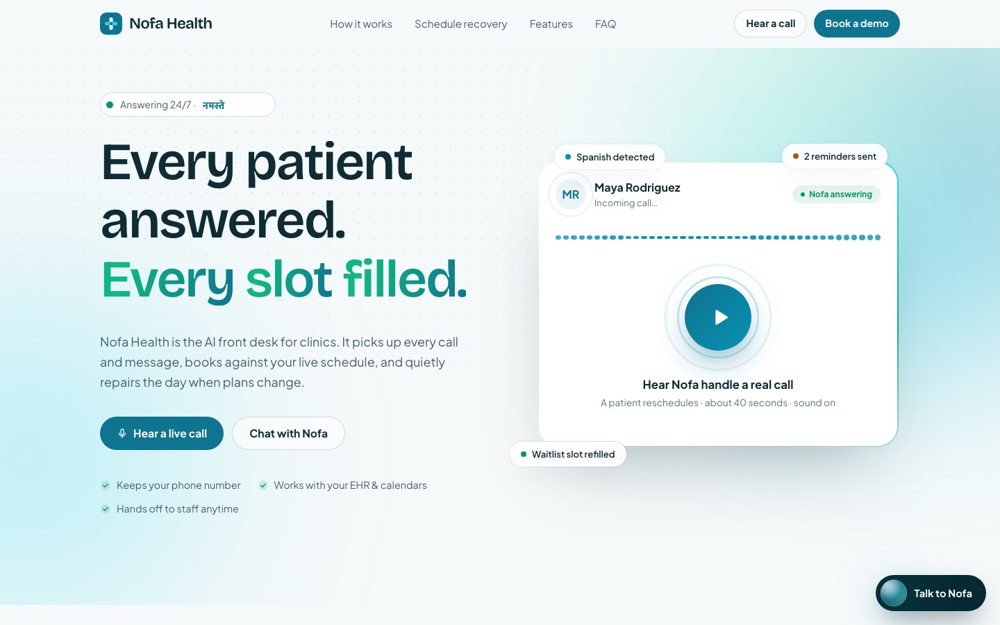
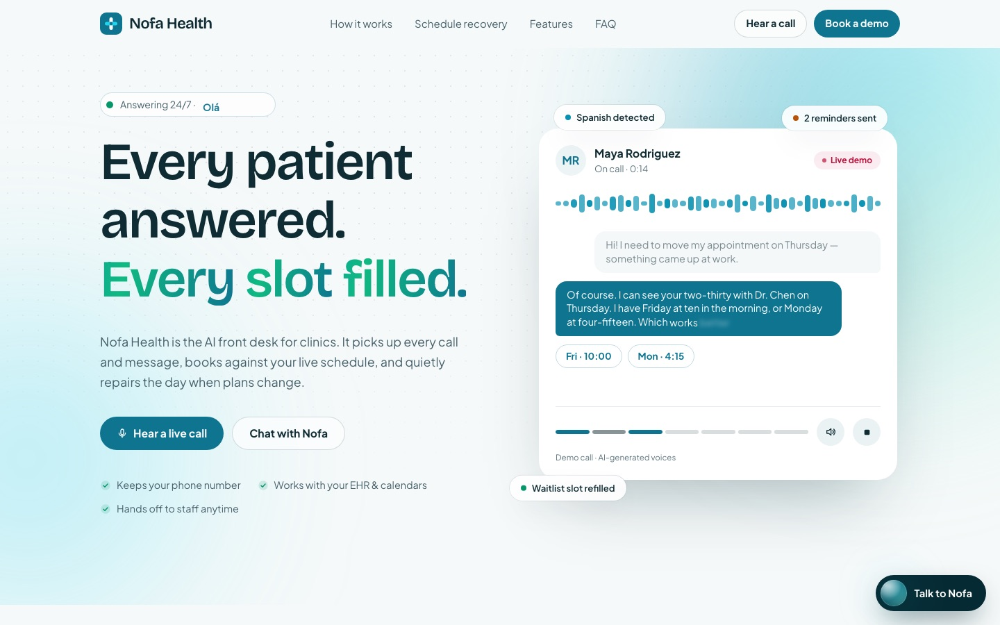
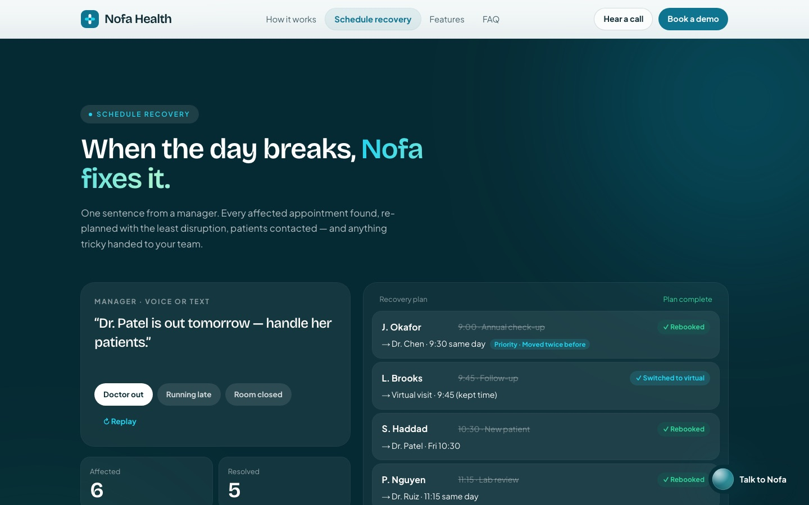
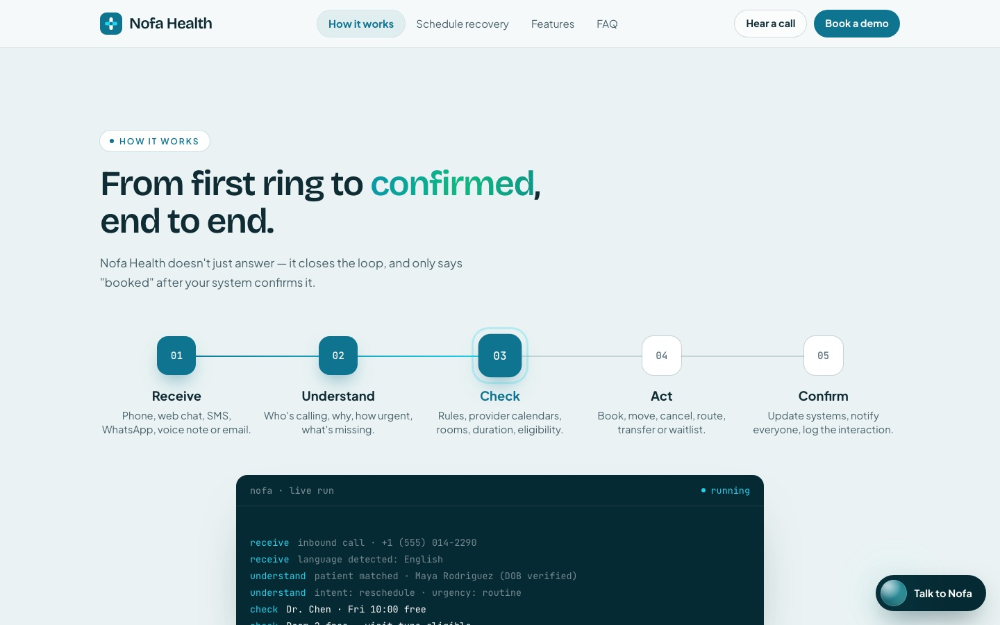
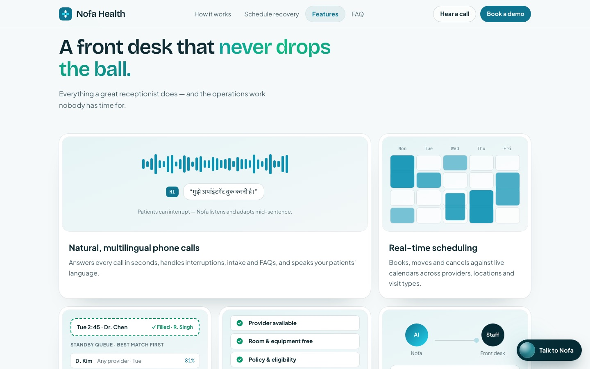
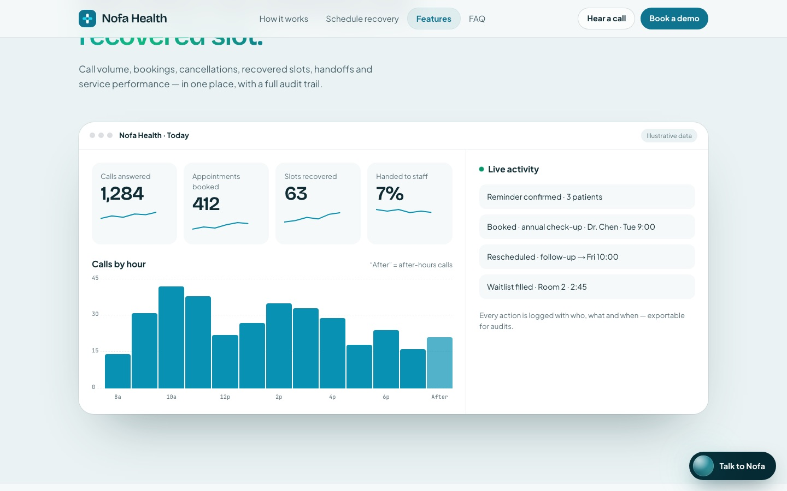
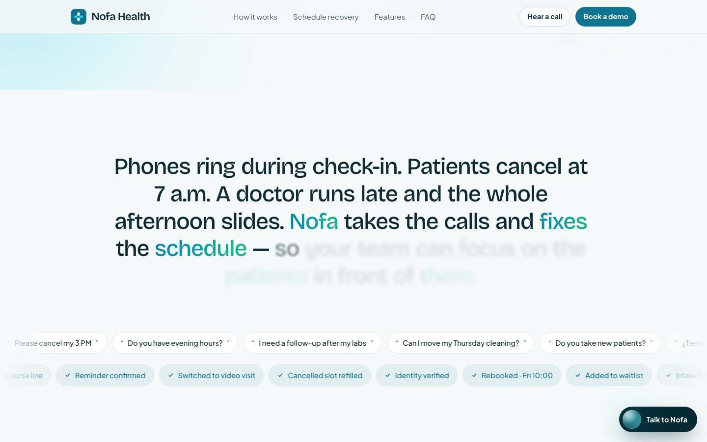
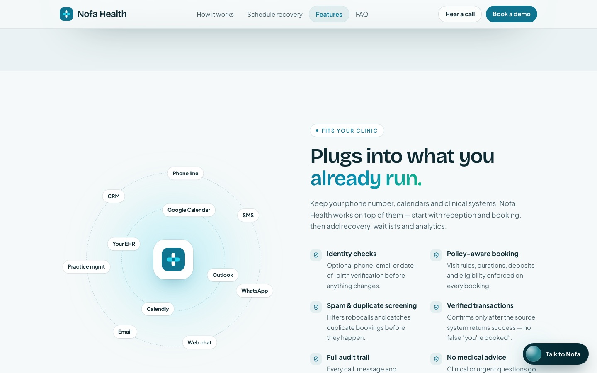
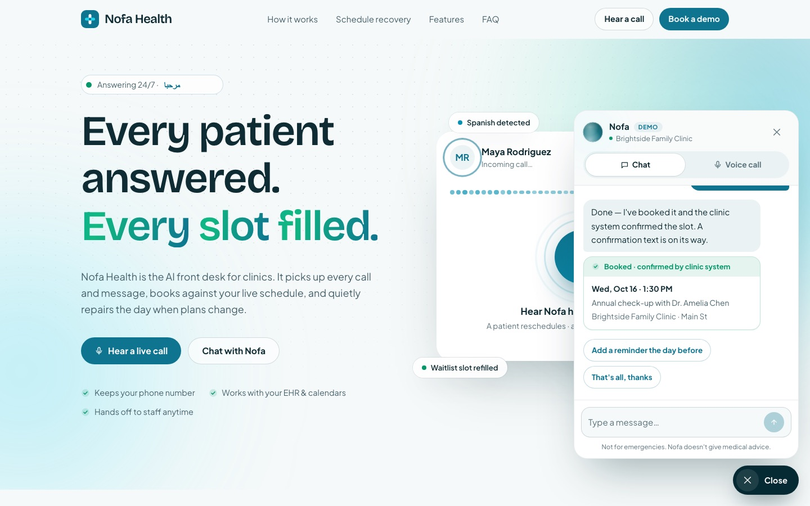
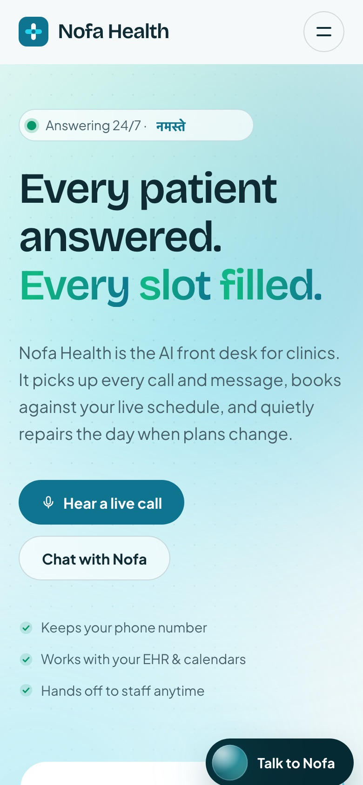

<p align="center">
  <a href="https://nofa-health.vercel.app">
    
  </a>
</p>

<h1 align="center">Nofa Health — AI front desk for clinics</h1>

<p align="center">
  <a href="https://nofa-health.vercel.app"><b>Live site</b></a> ·
  Next.js 14 · TypeScript · Tailwind CSS · Motion ·
  A product by <a href="https://www.zovak.tech"><b>Zovak</b></a>
</p>

Marketing site + interactive demo for a healthcare AI receptionist and
scheduling agent (voice + chat). It answers every call and message, books
against live availability, and repairs the schedule when plans change.

## Screenshots

<table>
  <tr>
    <td width="50%"><br/><sub><b>Hero</b> — press play to hear a patient and Nofa on a call</sub></td>
    <td width="50%"><br/><sub><b>Demo call</b> — voices, live captions, slots and booking in sync</sub></td>
  </tr>
  <tr>
    <td><br/><sub><b>Schedule recovery</b> — one command re-plans every affected appointment</sub></td>
    <td><br/><sub><b>How it works</b> — receive → understand → check → act → confirm</sub></td>
  </tr>
  <tr>
    <td><br/><sub><b>Features</b> — bento cards with live mini-animations</sub></td>
    <td><br/><sub><b>Visibility</b> — calls, bookings and recovered slots (sample data)</sub></td>
  </tr>
  <tr>
    <td><br/><sub><b>Statement</b> — words light up as you scroll</sub></td>
    <td><br/><sub><b>Fits your clinic</b> — integrations and trust controls</sub></td>
  </tr>
  <tr>
    <td><br/><sub><b>Chat assistant</b> — books and shows a verified confirmation</sub></td>
    <td align="center"><br/><sub><b>Mobile</b></sub></td>
  </tr>
</table>

## Run locally

```bash
npm install
npm run dev      # http://localhost:3000
npm run build && npm start
```

## Where things live

| Path | What |
| --- | --- |
| `src/config/site.ts` | Brand name, tagline, URL, contact email, nav — rename the product here |
| `src/components/sections/*` | Page sections (Hero, Channels, Workflow, Recovery, Features, Dashboard, Trust, FAQ, CTA) |
| `src/components/assistant/*` | Floating chat + voice widget and the animated voice orb |
| `src/lib/agent/client.ts` | **The only API the widget calls** — `sendChatMessage`, `startVoiceSession` |
| `src/lib/agent/demo.ts` | Scripted demo used while `AGENT_DEMO = true` |
| `src/lib/agent/tools.ts` | Tool contract for the backend agent (check availability, book, reschedule, cancel, waitlist, handoff) |
| `src/app/api/agent/chat` | Chat endpoint stub (returns 501) |
| `src/app/api/agent/session` | Voice session (ephemeral key) endpoint stub (returns 501) |

## Connecting the backend (OpenAI Agents SDK)

1. `npm i @openai/agents zod` and add `OPENAI_API_KEY` to `.env.local`.
2. **Chat:** implement `src/app/api/agent/chat/route.ts` — build the agent with
   the tools from `src/lib/agent/tools.ts`, `run()` it on the incoming
   messages, and return `{ content, quickReplies?, booking? }` (`AgentReply`).
3. **Voice:** implement `src/app/api/agent/session/route.ts` to mint an
   ephemeral Realtime key server-side, then fill in `startLiveVoiceSession()`
   in `src/lib/agent/client.ts` with the SDK's `RealtimeSession`.
4. Set `AGENT_DEMO = false` in `src/lib/agent/client.ts` (also hides the
   "Demo" badge).

Rule from the product brief: the agent only tells a patient they're booked
after the scheduling system returns `{ ok: true }`.

## Demo call audio

"Hear a live call" plays a short scripted call between a patient and Nofa
(`src/lib/agent/demo-call.json`). By default the visitor's browser voices it
with two different built-in voices. For studio-quality voices:

```bash
echo "OPENAI_API_KEY=sk-..." >> .env.local
npm run demo:audio   # writes public/audio/demo/*.mp3 + manifest.json
```

The site automatically prefers those recordings once they exist.

## Before launch

- Replace `url` and `contactEmail` in `src/config/site.ts`.
- Dashboard numbers are illustrative sample data (labelled on the page).
