<p align="center">
  <a href="https://nofa-health.zovak.tech">
    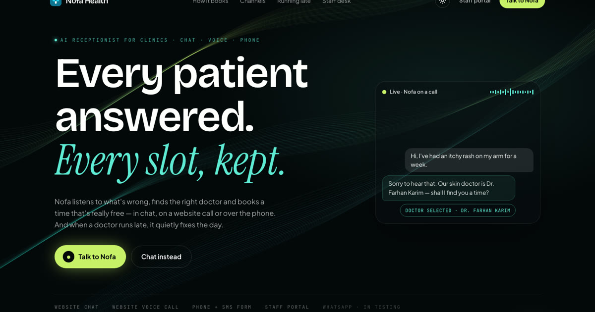
  </a>
</p>

<h1 align="center">Nofa Health — AI front desk for clinics</h1>

<p align="center">
  <a href="https://nofa-health.zovak.tech"><b>Live site</b></a> ·
  Next.js 14 · TypeScript · Tailwind CSS · Motion · Canvas ·
  A product by <a href="https://www.zovak.tech"><b>Zovak</b></a>
</p>

Marketing site and **private live demo** for Nofa, an AI receptionist that books
appointments by chat, website voice call and phone, and quietly repairs the day when
a doctor runs late. The brain is **ZOVAK** (Python, FastAPI, OpenAI Agents SDK, GPT-Live)
in the separate `zovak-backend` repo; this site is its face.

> **Marketing demo only.** The live chat, voice and staff portal are private (team access
> code), and every message and call costs money. Please follow the test scripts shown
> next to the chat.

## Screenshots

<table>
  <tr>
    <td width="50%">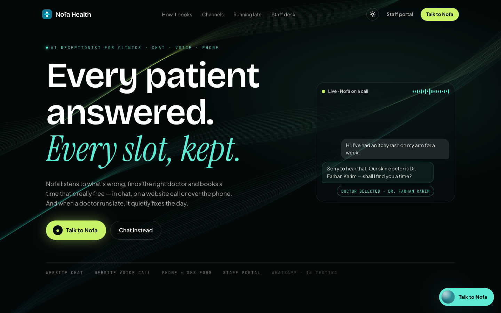<br/><sub><b>Hero</b> — flowing light ribbons behind the whole page, live call ticker</sub></td>
    <td width="50%">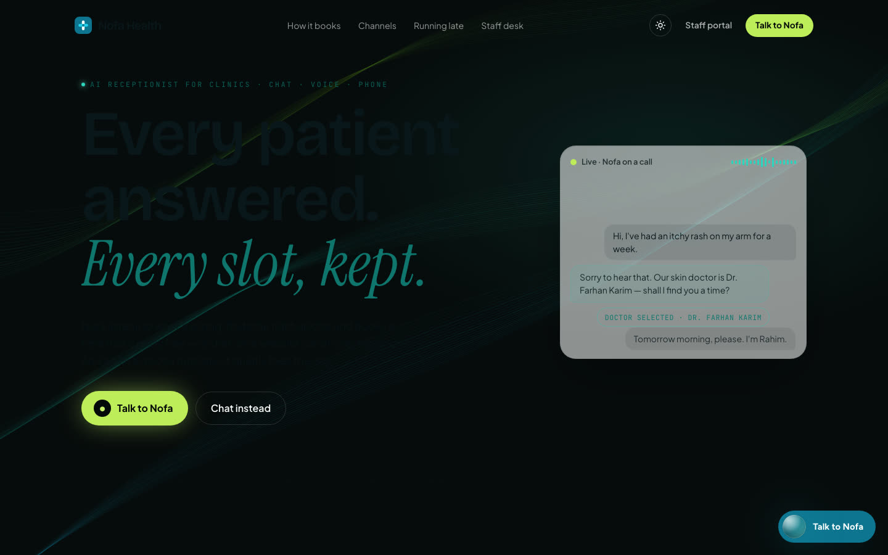<br/><sub><b>Light theme</b> — sun/moon switch, remembered per browser</sub></td>
  </tr>
  <tr>
    <td>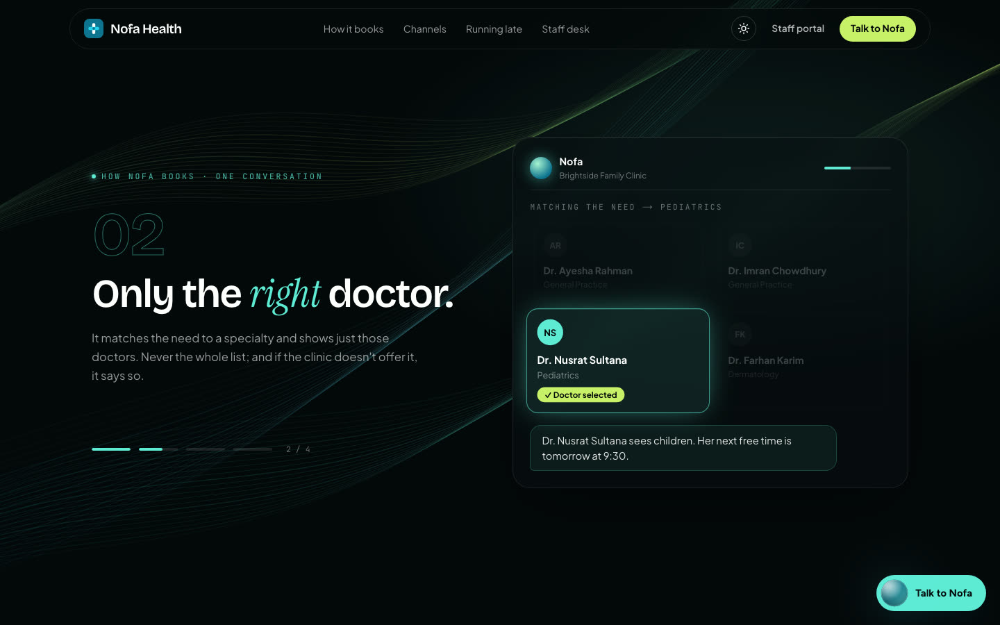<br/><sub><b>How Nofa books</b> — a pinned, scroll-driven story in four chapters</sub></td>
    <td>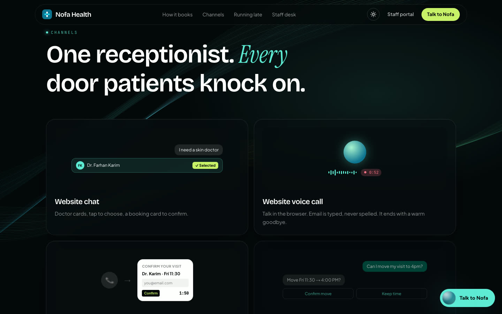<br/><sub><b>Channels</b> — chat, website voice, phone + SMS form, WhatsApp</sub></td>
  </tr>
  <tr>
    <td>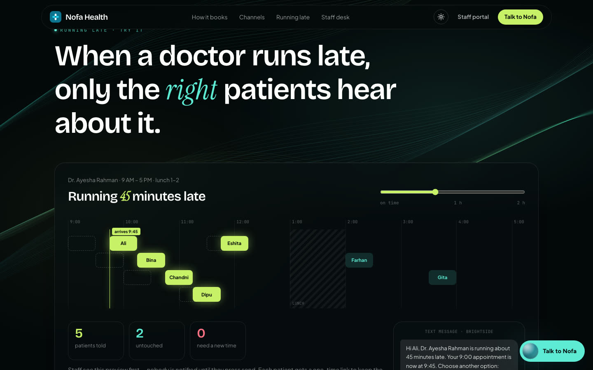<br/><sub><b>Running late</b> — drag the delay; only the reached patients move</sub></td>
    <td>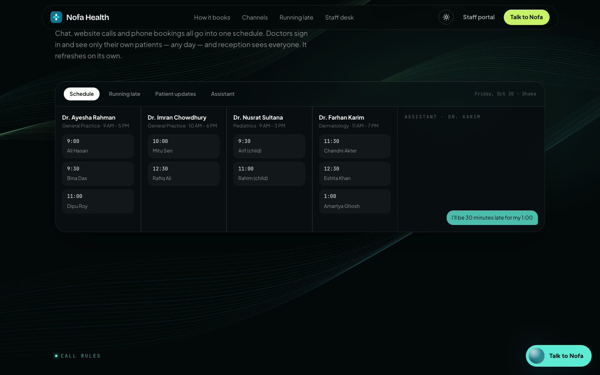<br/><sub><b>Staff desk</b> — every booking lands on the right doctor's day</sub></td>
  </tr>
  <tr>
    <td>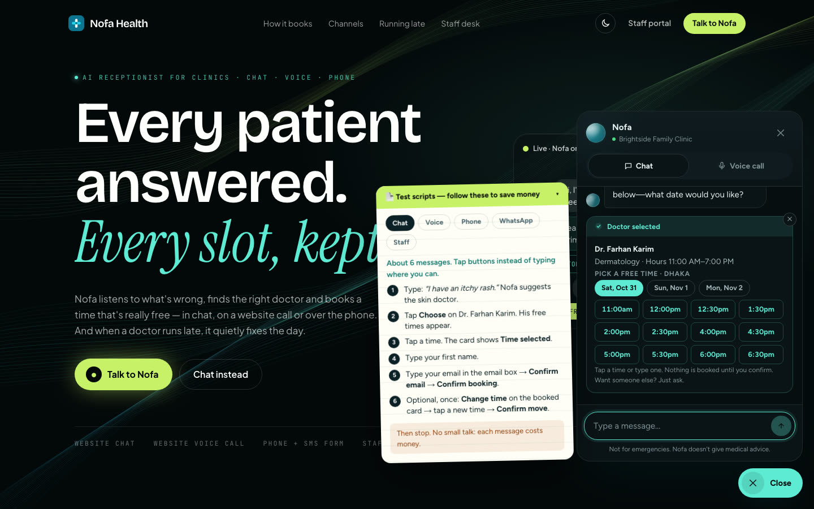<br/><sub><b>Live chat</b> — the right doctor, then their real free times as buttons; test scripts float alongside</sub></td>
    <td><br/><sub><b>Booked</b> — confirmed by the calendar; one time change allowed</sub></td>
  </tr>
  <tr>
    <td>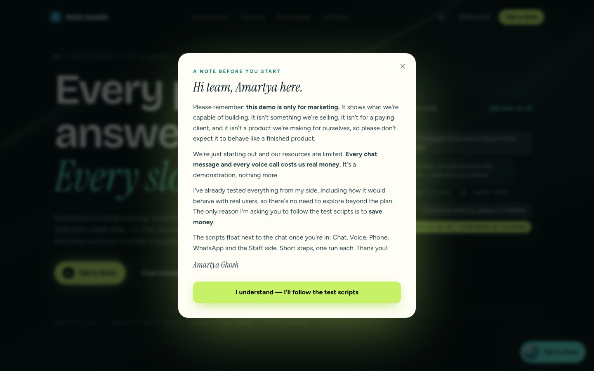<br/><sub><b>Private demo</b> — team code, then a note to accept before using it</sub></td>
    <td>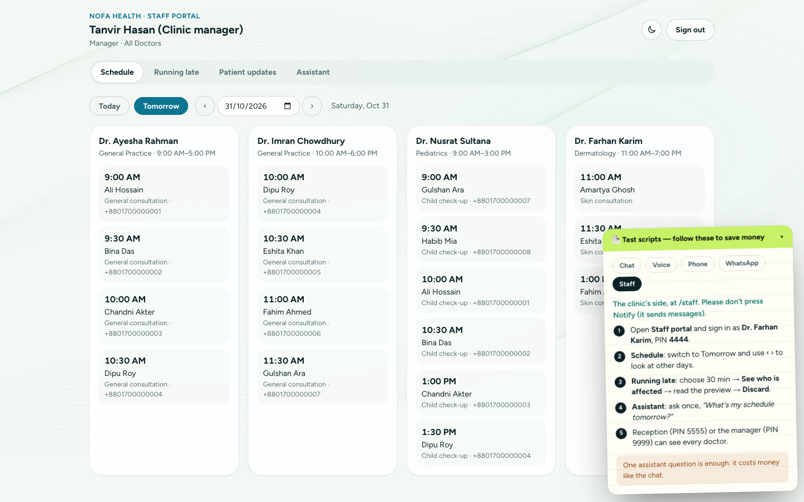<br/><sub><b>Staff portal</b> (<code>/staff</code>) — schedules, running late, patient updates, assistant</sub></td>
  </tr>
  <tr>
    <td align="center" colspan="2">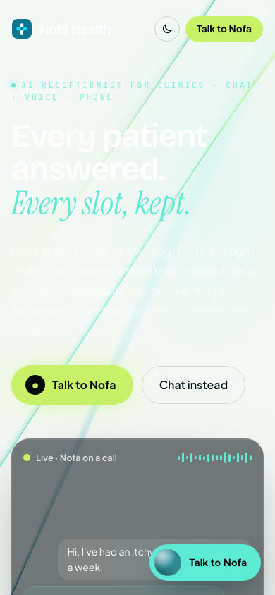<br/><sub><b>Mobile</b></sub></td>
  </tr>
</table>

## What the live demo does

- **Chat & website voice call** (floating widget): asks what's wrong, offers only the
  matching doctor(s), shows that doctor's free times as buttons, takes the name, an email
  typed in a box, and books only after an explicit confirm. One time change after booking,
  move/cancel, warm goodbyes that end calls by themselves. Replies stream in as they're
  written; cards appear only when relevant and can be hidden.
- **Phone** (Telnyx → GPT-Live): the same receptionist; confirming texts a 2-minute form.
- **Staff portal** (`/staff`): demo PINs, any day's schedule per doctor, "running late"
  with a preview before anyone is notified, patient updates, staff assistant.
- **Private**: the widget and portal need the team access code and the note accepted;
  the money-spending API routes answer 401 until then.

## Run locally

```bash
npm install
npm run dev      # http://localhost:3000
```

Needs the ZOVAK backend running on `http://127.0.0.1:8000` (see `zovak-backend`).
`.env.local`:

```bash
ZOVAK_API_URL=http://127.0.0.1:8000
NEXT_PUBLIC_AGENT_LIVE=true
DEMO_ACCESS_CODE=<team access code>
```

## Deploy (Vercel + ngrok to ZOVAK on your laptop)

1. **ZOVAK** (`zovak-backend/.env`): `PUBLIC_BASE_URL=https://<your-ngrok-domain>` and
   `SITE_API_KEY=<random>` (`python3 -c "import secrets; print(secrets.token_urlsafe(32))"`).
   Restart it and run ngrok on port 8000 with that domain.
2. **Vercel → Environment Variables:** `ZOVAK_API_URL=https://<your-ngrok-domain>`,
   `ZOVAK_SITE_KEY=<same random value>`, `DEMO_ACCESS_CODE=<team code>`,
   `NEXT_PUBLIC_AGENT_LIVE=true`.
3. The site works while your laptop, ZOVAK and ngrok are running.

Through the tunnel ZOVAK only answers this site's server (it must send the site key);
everyone else gets "Not found" except the phone/WhatsApp webhooks and form pages.

## Where things live

| Path | What |
| --- | --- |
| `src/config/backend.ts` | **The one place for ZOVAK's address** (local by default; your ngrok URL for Vercel) |
| `src/config/site.ts` | Brand name, tagline, URL, contact email |
| `src/app/page.tsx`, `src/components/night/*` | The animated homepage: ribbons backdrop, hero, booking story, channels, running-late lab, staff desk, call rules |
| `src/components/assistant/AssistantWidget.tsx` | Chat + voice widget: doctor cards, time buttons, email box, booking/move cards |
| `src/components/assistant/DemoAccess.tsx` | Private demo gate, Amartya's note, floating test scripts (edit `SCRIPTS`) |
| `src/lib/access.ts`, `src/middleware.ts`, `src/app/api/demo-access` | Access code check (server-side), cookie, 401 on API routes until unlocked |
| `src/lib/agent/client.ts` | Browser side: streamed chat, voice (WebRTC), card polling and actions |
| `src/lib/agent/zovak.ts` | Server side: every call to ZOVAK (site key, ngrok header) |
| `src/app/api/agent/*`, `src/app/api/staff/*` | Next.js routes that forward to ZOVAK |
| `src/app/staff/page.tsx` | Staff portal |
| `src/app/globals.css`, `tailwind.config.ts` | Light/dark theme colours (CSS variables) |
| `src/components/sections/*` | The previous homepage's sections (kept for reference, not used) |

The full step-by-step documentation with code is `zovak-backend/docs/ZOVAK_Documentation.pdf`,
and every test case is in `zovak-backend/docs/ZOVAK_Test_Plan.pdf`.
